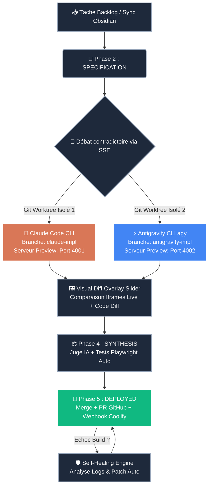

# ⚡ VibeFlow Studio — Cockpit Central (Second Cerveau)

> [!SUCCESS] État de la Production : **OPÉRATIONNEL**
> 🌐 **App Live** : [vibeflow.capstation.fr](https://vibeflow.capstation.fr) | 🐳 **Infra** : Coolify (`8kiofkrrwphlaus9iikr7m0g`) | 💸 **Coût API** : `0.00 €` (Mode CLI Pro)

## 🧭 Navigation Rapide (Map of Content)
- **Stratégie** : [[01_Master_Roadmap|🚀 Master Roadmap Complète]] | [[03_Kanban_Tasks|📌 Backlog Synchronisé]]
- **Frontend** : [[KanbanBoard.tsx]] | [[DualBranchArena.tsx]] | [[CloudCLI.tsx]] | [[CliSetupWizard.tsx]] | [[Toolbox.tsx]]
- **Backend & Infra** : [[self-healing.ts]] | [[git-worktree-manager.ts]] | [[obsidian-sync.ts]] | [[Docker_Coolify_Infra]]

## 🔄 Architecture d'Exécution Réelle Dual-Agent



## 🔥 Tâches Critiques en Cours (Dataview)
```dataview
TABLE WITHOUT ID
  file.link AS "Module",
  priority AS "Priorité",
  agent_owner AS "Agent",
  phase AS "Phase"
FROM #vibeflow
WHERE status = "in-progress" OR priority = "critical"
SORT priority ASC
```
