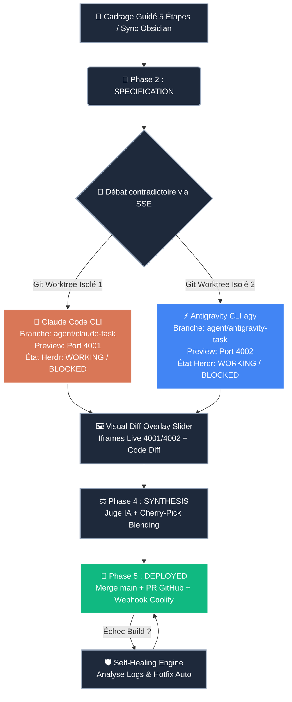

# ⚡ VibeFlow Studio — Cockpit Central

> [!SUCCESS] État de la Production : **OPÉRATIONNEL**
> 🌐 **Application Live** : [vibeflow.capstation.fr](https://vibeflow.capstation.fr) | 🐳 **Hébergement** : VPS Coolify (`8kiofkrrwphlaus9iikr7m0g`) | 💸 **Coût Jetons** : `0.00 €` (Mode CLIs Pro par défaut)
> 🧠 **Second Cerveau Obsidian** : `http://192.168.1.203:27123` (Bearer Auth Actif & Synchronisé)

---

## 🧭 Navigation Rapide du Coffre (Map of Content)

- 🚀 **Stratégie & Roadmap** : [[01_Master_Roadmap|Master Roadmap Industrielle (8 Phases Complètes)]]
- 🏗️ **Architecture & Infra** : [[02_Architecture_Systeme|Architecture Système, Dual-Agent Worktrees & Moteur Herdr]]
- 📌 **Backlog des Tâches** : Dossier [[03_Kanban_Tasks/|03_Kanban_Tasks (Fiches Tâches Synchronisées)]]
- 💬 **Débats d'Architecture** : Dossier [[04_AI_Debates_Logs/|04_AI_Debates_Logs (Transcriptions Débats Contradictoires)]]
- 🛡️ **Rapports d'Auto-Guérison** : Dossier [[05_Self_Healing_Reports/|05_Self_Healing_Reports (Post-Mortem CI/CD)]]
- 🧭 **Cahiers des Charges & Cadrages** : Dossier [[06_Project_Blueprints/|06_Project_Blueprints (Charters de Projets)]]
- 📐 **Spécifications OpenAPI & Mermaid** : Dossier [[07_API_Specs/|07_API_Specs (Architecture Continue)]]
- 📦 **Briques Consensuelles Clé en Main** : Dossier [[08_Toolbox_Templates/|08_Toolbox_Templates (Templates de Modules)]]

---

## 🔄 Flux d'Exécution Réel Dual-Agent (Zéro Mock)



---

## 🔥 Tâches Actives & Prioritaires (Dataview)

```dataview
TABLE WITHOUT ID
  file.link AS "Tâche",
  priority AS "Priorité",
  status AS "Statut",
  agent_owner AS "Agent Assigné"
FROM #vibeflow/task
SORT priority ASC
```

---

## 🧭 Cahiers des Charges & Cadrages Projets (Dataview)

```dataview
TABLE WITHOUT ID
  file.link AS "Projet",
  slug AS "Slug",
  status AS "Statut Cadrage",
  created AS "Date de Création"
FROM #vibeflow/blueprint
SORT created DESC
```

---

## 📊 Modules et Composants Clés de la Plateforme

| Composant / Module | Fichier Source | Rôle Principal |
| :--- | :--- | :--- |
| **Kanban Réactif 5 Phases** | `src/components/kanban/KanbanBoard.tsx` | Pilotage visuel du backlog au déploiement en production |
| **Arène Dual-Branch** | `src/components/arena/DualBranchArena.tsx` | Débat contradictoire, Code Diff, Slider Visuel & Synthèse Hybride |
| **Cadrage de Projet (5 Étapes)** | `src/components/dashboard/ProjectFramingGuide.tsx` | Cadrage complet, spécification Gherkin & sync Obsidian avant vibe coding |
| **API Cadrage Blueprint** | `src/app/api/projects/frame-blueprint/route.ts` | Génération IA du cahier des charges, 4 jalons, 6 tâches et sync Obsidian |
| **Terminal CloudCLI Interactif** | `src/components/terminal/XtermTerminal.tsx` | xterm.js 4 onglets, streaming PTY et barre d'actions 1-clic Herdr |
| **Détecteur d'État Herdr** | `src/lib/agent-state-detector.ts` | Détection regex temps réel `WORKING`, `BLOCKED`, `IDLE` et actions rapides |
| **Orchestrateur de Preview** | `src/lib/preview-orchestrator.ts` | Lancement de serveurs dev sur ports dynamiques (4001/4002) + auto-sleep 15m |
| **Suivi des Économies 0€** | `src/components/dashboard/TokenSavingsTracker.tsx` | Compteur en direct des jetons économisés via les sessions CLI Pro officielles |
| **Contrôleur Démon 24/7** | `src/components/dashboard/DaemonControllerModal.tsx` | Modal de monitoring et de déclenchement manuel de la boucle autonome |
| **Moteur Démon Autonome** | `src/lib/daemon.ts` | Détection de dette, génération de tâches d'optimisation et exécution continue |
| **Assistant CLIs Pro** | `src/components/setup/CliSetupWizard.tsx` | Assistant de configuration 0€ Claude Pro & Gemini Pro persistant |
| **Git Worktrees Manager** | `src/lib/git-worktree-manager.ts` | Isolation physique hermétique des dossiers `/tmp/vibeflow-worktrees/` |
| **Moteur Sync Obsidian** | `src/lib/obsidian-sync.ts` | Pont bidirectionnel UTF-8 strict (Kanban, Débats, Rapports, Blueprints) |
| **Auto-Guérison CI/CD** | `src/lib/self-healing.ts` | Analyse IA des logs d'erreur de build Coolify & génération de patchs auto |
| **Boîte à Outils (Toolbox)** | `src/components/toolbox/Toolbox.tsx` | Détection, installation et vérification des dépendances techniques |
| **Tests E2E & Web Vitals** | `src/lib/playwright-runner.ts` | Audit automatisé Playwright Headless (LCP, CLS, TTFB, Hydration) |
| **Tunnels Mobiles Éphémères** | `src/lib/tunnel-manager.ts` | Liens publics temporaires et QR codes pour tests réels sur smartphone |
| **Dashboard Analytics & Vélocité** | `src/components/dashboard/AnalyticsDashboard.tsx` | Visualisation MTTR, victoires duels, tendance de vélocité 7j et ROI tokens |
| **Détecteur Multi-Stacks Polyglotte** | `src/lib/stack-detector.ts` | Détection & exécution dev auto (Next.js, Vite, Nuxt, FastAPI, Rust, Go) |
| **Documentation Continue & OpenAPI** | `src/lib/api-docs-generator.ts` | Génération de specs OpenAPI 3.1 & diagrammes Mermaid ER / Architecture |
| **Marketplace Skills & Personas** | `src/lib/agent-skills.ts` | Personas personnalisés et compétences métiers (OWASP, 60fps, WCAG) |
