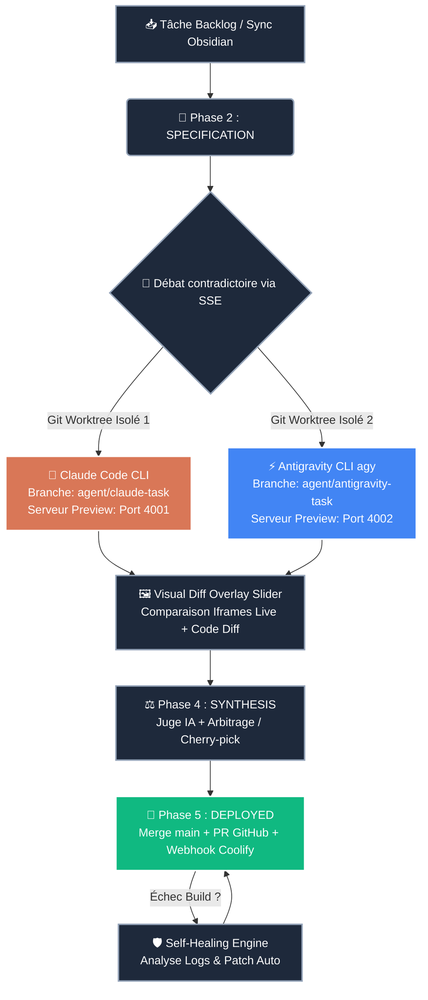

# ⚡ VibeFlow Studio — Cockpit Central

> [!SUCCESS] État de la Production : **OPÉRATIONNEL**
> 🌐 **Application Live** : [vibeflow.capstation.fr](https://vibeflow.capstation.fr) | 🐳 **Hébergement** : VPS Coolify (`8kiofkrrwphlaus9iikr7m0g`) | 💸 **Coût Jetons** : `0.00 €` (Mode CLIs Pro par défaut)

---

## 🧭 Navigation Rapide du Coffre (Map of Content)

- 🚀 **Stratégie & Roadmap** : [[01_Master_Roadmap|Master Roadmap Industrielle (4 Phases)]]
- 🏗️ **Architecture & Infra** : [[02_Architecture_Systeme|Architecture Système & Dual-Agent Worktrees]]
- 📌 **Backlog des Tâches** : Dossier [[03_Kanban_Tasks/|03_Kanban_Tasks (Tâches Synchronisées)]]
- 💬 **Débats d'Architecture** : Dossier [[04_AI_Debates_Logs/|04_AI_Debates_Logs (Transcriptions)]]
- 🛡️ **Rapports d'Auto-Guérison** : Dossier [[05_Self_Healing_Reports/|05_Self_Healing_Reports (Post-Mortem CI/CD)]]

---

## 🔄 Flux d'Exécution Physique Dual-Agent



---

## 🔥 Tâches Actives & Prioritaires (Dataview)

```dataview
TABLE WITHOUT ID
  file.link AS "Tâche",
  priority AS "Priorité",
  status AS "Statut",
  agent_owner AS "Agent Assigné"
FROM #vibeflow/task
SORT priority ASC
```

---

## 📊 Modules et Fichiers Clés du Codebase

| Composant | Fichier Source | Rôle Principal |
| :--- | :--- | :--- |
| **Kanban 5 Phases** | `src/components/kanban/KanbanBoard.tsx` | Pilotage visuel du backlog au déploiement |
| **Arène Dual-Branch** | `src/components/arena/DualBranchArena.tsx` | Débat contradictoire, Code Diff & Visual Slider |
| **Terminal CloudCLI** | `src/components/layout/CloudCLI.tsx` | Terminal xterm.js interactif 4 onglets |
| **Assistant CLIs Pro** | `src/components/setup/CliSetupWizard.tsx` | Configuration 0€ Claude Pro & Antigravity Pro |
| **Git Worktrees** | `src/lib/git-worktree-manager.ts` | Isolation physique des dossiers `/tmp/vibeflow-worktrees/` |
| **Sync Obsidian** | `src/lib/obsidian-sync.ts` | Pont bidirectionnel base PostgreSQL ↔ Notes Markdown |
| **Auto-Guérison CI/CD** | `src/lib/self-healing.ts` | Diagnostic des logs d'erreur Coolify & hotfix auto |
