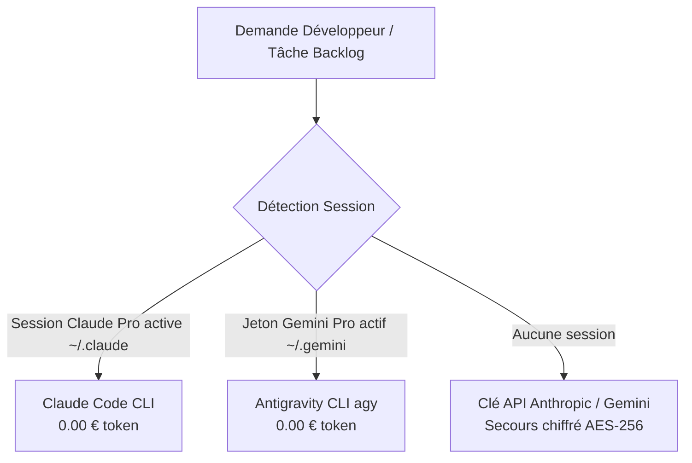

# 🏗️ VibeFlow Studio — Architecture Système & Isolation Worktree

> [!INFO] Vue d'Ensemble
> Ce document décrit les flux d'exécution, la stratégie d'isolation des processus et la persistance des sessions officielles Claude Pro et Gemini Pro sur le conteneur Coolify.

---

## 1. Isolation Physique des Branches (Git Worktrees)

Lorsqu'une tâche entre en phase `DUAL_DEV`, VibeFlow Studio ne fait jamais de `git checkout` dans l'espace principal. Le module `src/lib/git-worktree-manager.ts` crée deux dossiers isolés :

```
/tmp/vibeflow-worktrees/
  └── [taskId]/
        ├── claude-impl/       --> Branche: agent/claude-[taskId]
        ├── antigravity-impl/  --> Branche: agent/antigravity-[taskId]
        └── synthesis-impl/    --> Branche: synthesis/[taskId]
```

### Avantages Majeurs
1. **Zéro Conflit Local** : Claude Code et Antigravity modifient, compilent et testent leurs fichiers sans interférer.
2. **Exécution Parallèle** : Les commandes de compilation `npm run build` ou `npx tsc` s'exécutent simultanément.
3. **Nettoyage Automatisé** : Dès validation de la tâche, les worktrees sont supprimés (`git worktree remove --force`) et la base Git est épurée (`git worktree prune`).

---

## 2. Stratégie Économique "Pro-First" (0€ de Frais API)



* Les sessions officielles sont montées via des volumes persistants Coolify :
  * `/root/.claude` ➔ `/home/nextjs/.claude`
  * `/root/.gemini` ➔ `/home/nextjs/.gemini`
* Même après un redéploiement d'image Docker, vos comptes restent connectés sans reconfiguration.

---

## 3. Synchronisation Bidirectionnelle Obsidian

* **Stockage Local** : `obsidian-vault/VibeFlow/`
* **API REST Locale** : `http://192.168.1.203:27123/vault/VibeFlow/`
* Chaque modification d'état sur le Kanban met à jour automatiquement la fiche correspondante avec la check-list des sous-tâches et l'historique des débats.
