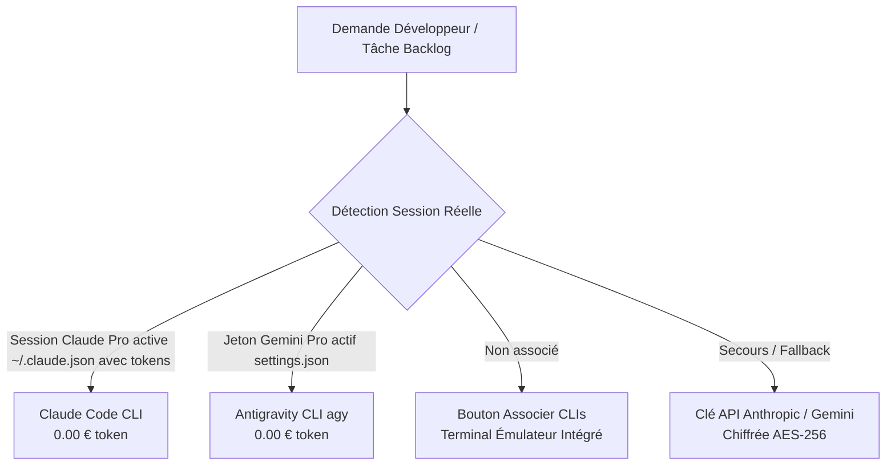

# 🏗️ VibeFlow Studio — Architecture Système & Spécifications Techniques

> [!INFO] Vue d'Ensemble
> Ce document décrit les flux d'exécution réels, la stratégie d'isolation des processus, la détection d'état des agents inspirée de Herdr, l'orchestration des previews éphémères et la persistance des sessions officielles Claude Pro et Gemini Pro sur le conteneur Coolify.

---

## 1. Isolation Physique des Branches (Git Worktrees)

Lorsqu'une tâche entre en phase `DUAL_DEV`, VibeFlow Studio n'exécute jamais de `git checkout` dans l'espace principal afin d'éviter tout conflit de concurrence entre Claude et Antigravity.
Le module `src/lib/git-worktree-manager.ts` crée une hiérarchie isolée par tâche sous `/tmp/vibeflow-worktrees/` :

```
/tmp/vibeflow-worktrees/
  └── [taskId]/
        ├── claude-impl/       --> Branche Git: agent/claude-[taskId]
        ├── antigravity-impl/  --> Branche Git: agent/antigravity-[taskId]
        └── synthesis-impl/    --> Branche Git: synthesis/[taskId]
```

### Avantages Majeurs
1. **Zéro Conflit Local** : Claude Code CLI et Antigravity CLI modifient, compilent et testent leurs fichiers dans des dossiers distincts sans aucun risque d'écrasement mutuel.
2. **Exécution Parallèle des Builds** : Les commandes de vérification de types (`npx tsc --noEmit`) ou de build peuvent tourner en simultané dans chaque worktree.
3. **Nettoyage Automatisé du Cycle de Vie** : Dès que la tâche est fusionnée (`action === "merge"`), la fonction `cleanupTaskWorktrees(taskId)` supprime les dossiers (`git worktree remove --force`) et purge le dépôt (`git worktree prune`).

---

## 2. Serveurs de Prévisualisation Éphémères & Reverse-Proxy Multi-Port (`preview-orchestrator.ts`)

Pour alimenter le **Visual Diff Overlay Slider** dans `DualBranchArena.tsx`, VibeFlow Studio ne se contente pas de comparer du code statique : il compare le **rendu visuel dynamique** des deux implémentations en direct.

### Fonctionnement Technique
1. **Allocation Dynamique de Ports** : Le module `src/lib/preview-orchestrator.ts` réserve dynamiquement deux ports libres (par exemple `4001` pour Claude et `4002` pour Antigravity).
2. **Lancement en Arrière-Plan** : Un serveur de développement léger (`npm run dev -- -p [port]`) est démarré dans chaque dossier worktree.
3. **Reverse-Proxy Interne** : Les routes Next.js `/api/preview/[taskId]/claude` et `/api/preview/[taskId]/antigravity` redirigent le flux HTML/CSS/JS directement vers les `<iframe>` de l'arène.
4. **Gestion Responsiveness Multi-Viewport** : L'arène permet de basculer instantanément la largeur des iframes :
   - Desktop : `100%`
   - Tablette : `768px`
   - Mobile : `375px`
5. **Auto-Sleep pour Préservation de la RAM** : Un timer d'inactivité coupe automatiquement les processus de dev après 15 minutes sans interaction, évitant toute saturation de la mémoire sur le VPS Coolify.

---

## 3. Moteur de Détection d'État des Agents Inspiré de Herdr (`agent-state-detector.ts`)

Inspiré de l'architecture du projet open-source [herdrdev/herdr](https://github.com/herdrdev/herdr), VibeFlow Studio intègre un moteur d'inspection en flux continu des sorties de terminal des agents CLI.

### Détection Multimodale
- **Règles Regex officielles** : Chargement et parsing dynamique des motifs de détection de Herdr pour `@anthropic-ai/claude-code` et `antigravity-cli (agy)`.
- **Support Protocole OSC 7501** : Interception des séquences d'échappement ANSI émises par les CLIs lors d'une requête de confirmation utilisateur.
- **Les 3 États Canoniques** :
  1. `WORKING` : L'agent génère du code, exécute un outil ou analyse un fichier (animation pulse bleue/violette).
  2. `BLOCKED` : L'agent attend une permission humaine (confirmation d'écriture de fichier, validation d'une commande Bash, prompt de choix).
  3. `IDLE` : L'agent a terminé son tour ou attend une nouvelle consigne.

### Barre d'Actions Rapides 1-Clic dans le Terminal (`XtermTerminal.tsx`)
Dès que l'état passe à `BLOCKED`, une bannière interactive non intrusive apparaît au-dessus du terminal xterm.js :
- `[Autoriser (1. Yes)]` ➔ Envoie instantanément `1\r` ou `y\r` dans le PTY.
- `[Confirmer (Enter)]` ➔ Envoie un retour chariot `\r`.
- `[Annuler (Esc)]` ➔ Envoie le code d'échappement `\x1b`.

Les badges d'état sont également propagés en direct via Server-Sent Events (SSE) sur les cartes des agents dans l'arène de duel.

---

## 4. Stratégie Économique "Pro-First" & Diagnostic Strict des CLIs



### Diagnostic d'Authentification Strict (Zéro Faux Positif)
- **Claude Code CLI** : La présence d'un dossier vide `~/.claude` ou du binaire global ne suffit pas à déclarer la session active. Le système inspecte rigoureusement `~/.claude.json` pour vérifier la présence d'un objet `oauthAccount`, d'un `sessionKey` ou de tokens valides. À défaut, le statut affiche explicitement **Non associé (Connexion requise)**.
- **Antigravity CLI (`agy`)** : Le système vérifie que le fichier `~/.gemini/antigravity-cli/settings.json` contient un champ `geminiApiKey` non vide et valide (> 10 caractères). Sans ce jeton, le statut reste **Non associé (Jeton requis)**.
- **Terminal CloudCLI Universel** : Le panneau de terminal est désormais monté sur toutes les vues, y compris sur l'écran d'accueil avant création de projet. Le clic sur "Ouvrir terminal" maximise immédiatement la vue xterm.js (80vh) sur l'onglet ciblé (`claude` ou `antigravity`).
- **Commandes d'association en émulateur** :
  - `claude login` : Affiche la procédure OAuth officielle ou permet de saisir `claude key sk-ant-...`.
  - `agy login` : Affiche le lien direct vers Google AI Studio et permet d'associer le jeton avec `agy token AIzaSy...`.
- Les sessions officielles sont montées via des volumes persistants Coolify :
  - `/root/.claude` ➔ `/home/nextjs/.claude`
  - `/root/.gemini` ➔ `/home/nextjs/.gemini`
- Même après un rebuild complet de l'image Docker, vos accès Pro restent connectés sans ressaisie de jeton.
- Le composant `src/components/dashboard/TokenSavingsTracker.tsx` affiche en temps réel les jetons réellement consommés (partant de 0.00 € en l'absence d'activité réelle).

---

## 5. Synthèse Hybride IA & Arbitrage Chirurgical Cherry-Pick (`DualBranchArena.tsx`)

Lorsque le débat contradictoire s'achève, le développeur et le Juge IA ne sont pas contraints de choisir arbitrairement l'un des deux agents. L'API `/api/tasks/[id]/hybrid-synthesis` permet de fusionner chirurgicalement le meilleur des deux mondes :
- **Claude Code Pro** : Sélectionné par défaut pour l'architecture, la modularité des types TypeScript, les schémas Zod et la gestion des erreurs.
- **Antigravity CLI** : Sélectionné par défaut pour les classes Tailwind CSS, la fluidité responsive 60fps et les animations micro-interactions.
- **Juge IA Multi-Critères** : Évaluation objective sur 4 piliers notés sur 10 (Architecture & Typage, Sécurité & Gestion d'erreurs, Performance & Modularité, Finition UI/UX).
- **Branche de Synthèse** : Le code fusionné est commité sur `synthesis/[taskId]` avant le merge définitif sur la branche principale du projet.

---

## 6. Moteur de Cadrage Guidé de Projet Avant Vibe-Coding (`ProjectFramingGuide.tsx`)

Pour éviter de démarrer le développement sans spécification claire (anti-pattern du "vibe coding aveugle"), VibeFlow Studio propose un assistant de cadrage en 5 étapes accessible depuis le tableau de bord ou la barre supérieure :
1. **Vision & Pitch** : Nom, pitch percutant, cible et fonctionnalité reine (*killer feature*).
2. **Matrice Technique** : Sélection des briques (Next.js, Prisma/PostgreSQL, NextAuth, Stripe, Tailwind, Coolify).
3. **Schéma & Entités Clés** : Définition des entités de la base de données.
4. **Règles d'Or des Agents** : Typage strict TypeScript (`no-any`), architecture Zéro-Mock, fluidité 60fps.
5. **Génération & Synchronisation Obsidian** : Synthèse instantanée par IA créant :
   - Un cahier des charges complet synchronisé dans `VibeFlow/06_Project_Blueprints/[slug]_Charter.md`.
   - 4 jalons méthodiques (*Architecture*, *MVP*, *UI/UX*, *Déploiement*).
   - 6 tâches initiales de backlog rédigées au format BDD Gherkin (*Given / When / Then*).

---

## 7. Démon Autonome 24/7 & Auto-Optimisation Continue (`daemon.ts`)

Pour les projets configurés en mode `AUTO`, le moteur de démon 24/7 de VibeFlow Studio opère en arrière-plan sans intervention humaine :
1. **Vérification de Disponibilité** : S'assure qu'aucune tâche n'est déjà en cours d'exécution sur le projet.
2. **Dépilage du Backlog** : S'il reste des tâches dans le backlog, il lance automatiquement le cycle dual-agent de la plus prioritaire.
3. **Génération Autonome de Tâches d'Optimisation** : Si le backlog est vide, le démon interroge l'IA pour auditer le code existant et créer automatiquement une tâche de refactoring (ex: amélioration des performances, résilience des erreurs réseau, couverture de tests de régression).
4. **Événements Temps Réel** : Chaque cycle est retransmis via SSE pour que l'interface reflète l'activité en continu.

---

## 8. Synchronisation Bidirectionnelle Obsidian & Second Cerveau (`obsidian-sync.ts`)

- **Stockage Local Disque** : `obsidian-vault/VibeFlow/`
- **API REST Locale** : `http://192.168.1.203:27123/vault/VibeFlow/` avec authentification Bearer.
- **Intégrité d'Encodage** : Flux UTF-8 strict (`Buffer.from(content, 'utf-8')` avec `Content-Type: text/markdown; charset=utf-8`) garantissant l'absence totale de caractères losanges corrompus (`\uFFFD`).
- **Crochets de Synchronisation Automatiques** :
  - Création ou mise à jour de tâche ➔ `VibeFlow/03_Kanban_Tasks/TASK-[ID]-[slug].md`
  - Fin de débat contradictoire ➔ `VibeFlow/04_AI_Debates_Logs/DEBATE-[ID].md`
  - Post-mortem auto-guérison Coolify ➔ `VibeFlow/05_Self_Healing_Reports/HEAL-[ID].md`
  - Cadrage guidé de projet ➔ `VibeFlow/06_Project_Blueprints/[slug]_Charter.md`

---

## 9. Hôtes Distants SSH & Runners Distribués (`ssh-service.ts`)

Pour déporter l'exécution des CLIs Pro (Claude Code, Antigravity) ou ouvrir des sessions de terminal directes sur une machine dédiée (Mac mini Apple Silicon, serveur de build, VPS) :
1. **Gestionnaire d'Hôtes SSH** : Stockage sécurisé des identifiants (clé privée avec passphrase ou mot de passe) dans `SystemSetting.ssh_hosts`.
2. **Sonde Système 1-Clic** : Détection automatique de l'OS (`macOS Darwin arm64` / `Linux`), de `hostname`, et de la présence des CLIs `claude` et `agy`.
3. **Terminal Interactif Déporté** : Nouvel onglet `SSH (Mac mini)` dans le terminal `CloudCLI` xterm.js avec commandes `ssh status`, `ssh test`, `ssh hosts`.
4. **Mode Remote Runner** : Possibilité de déléguer les prompts des agents de l'arène directement sur le Mac mini pour exploiter les abonnements Claude Pro déjà configurés localement (0€ de tokens API).

