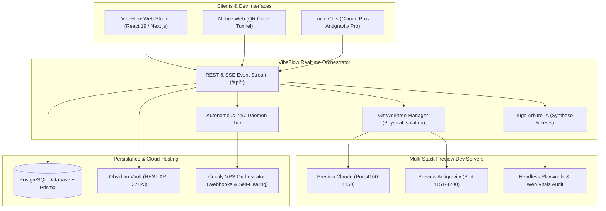

# 📐 Spécifications Techniques & Architecture Système — VibeFlow Studio

> [!NOTE] Documentation Vivante Auto-Générée (Phase 8.2)
> Cette note d'architecture et de spécifications API est synchronisée automatiquement à chaque commit et PR fusionnée sur main.
> Elle reflète l'état physique exact du code et du schéma de base de données.

---

## 🏛️ 1. Architecture Système Haute Disponibilité



---

## 🗄️ 2. Modèle de Données & Relations Relationnelles (Prisma ORM)

Ce diagramme entité-relation est compilé dynamiquement depuis le schéma de modélisation Prisma (`prisma/schema.prisma`).

```mermaid
erDiagram
    Project ||--o{ Milestone : "contains"
    Project ||--o{ ToolboxItem : "contains"
    Project ||--o{ Task : "contains"
    Project ||--o{ Deployment : "contains"
    Project ||--o{ ChatMessage : "contains"
    Milestone ||--o{ Task : "contains"
    Task ||--o{ AgentDebateLog : "contains"
    Project {
        String id PK
        String name
        String slug
        String vibeDescription
        String githubRepo
        String githubDefaultBranch
    }
    Milestone {
        String id PK
        String projectId
        Project project FK
        String title
        String description
        MilestonePhase phase FK
    }
    ToolboxItem {
        String id PK
        String projectId
        Project project FK
        String name
        String? description
        ToolboxCategory category FK
    }
    Task {
        String id PK
        String projectId
        Project project FK
        String? milestoneId
        Milestone? milestone FK
        String title
    }
    AgentDebateLog {
        String id PK
        String taskId
        Task task FK
        AgentSpeaker speaker FK
        String message
        String? codeDiffRef
    }
    Deployment {
        String id PK
        String projectId
        Project project FK
        String branch
        String? commitSha
        String? coolifyDeploymentUuid
    }
    ChatMessage {
        String id PK
        String projectId
        Project project FK
        String role
        String content
        String? milestoneRef
    }
    GlobalSettings {
        String id PK
        String? defaultGithubToken
        String? defaultAnthropicKey
        String? defaultCoolifyUrl
        String? defaultCoolifyToken
        String? redisUrl
    }
```

### Modèles Détectés (8)
- **`Project`** : 19 champs (id)
- **`Milestone`** : 13 champs (id)
- **`ToolboxItem`** : 15 champs (id)
- **`Task`** : 26 champs (id)
- **`AgentDebateLog`** : 13 champs (id)
- **`Deployment`** : 18 champs (id)
- **`ChatMessage`** : 8 champs (id)
- **`GlobalSettings`** : 10 champs (id)

---

## 🔌 3. Spécifications & Catalogue OpenAPI 3.1 (34 Routes)

| Route / Endpoint | Méthodes | Paramètres | Description & Rôle Métier |
| :--- | :---: | :---: | :--- |
| `/api/admin/init-db` | `POST` | — | VibeFlow Studio — Admin Database Initializer & Migration Route |
| `/api/agents/debate/[taskId]` | `GET` | taskId | API Route: /api/agents/debate/[taskId] |
| `/api/agents/orchestrate` | `POST` | — | API Route: /api/agents/orchestrate |
| `/api/agents/simulate-duel` | `POST` | — | VibeFlow Studio — Real Multi-Agent Duel & Synthesis Engine |
| `/api/daemon/tick` | `GET` `POST` | — | VibeFlow Studio — Daemon Trigger Route: /api/daemon/tick |
| `/api/deployments` | `GET` `POST` | — | API Route: /api/deployments |
| `/api/deployments/[id]/retry-healing` | `POST` | id | VibeFlow Studio — API Route: Trigger Self-Healing on Deployment |
| `/api/events` | `GET` | — | VibeFlow Studio — Server-Sent Events (SSE) Route |
| `/api/obsidian/sync` | `GET` `POST` | — | VibeFlow Studio — API Route: Obsidian Synchronization |
| `/api/preview/[taskId]/tunnel` | `POST` | taskId | VibeFlow Studio — API Route: Mobile Preview Tunnel |
| `/api/preview/[taskId]/[agent]` | `GET` | taskId, agent | VibeFlow Studio — API Route: Reverse-Proxy Preview (Root) |
| `/api/preview/[taskId]/[agent]/[...slug]` | `GET` | taskId, agent | VibeFlow Studio — API Route: Reverse-Proxy Preview (Assets & Subpaths) |
| `/api/projects/analyze-github` | `POST` | — | API Route: /api/projects/analyze-github |
| `/api/projects/frame-blueprint` | `POST` | — | VibeFlow Studio — API Route: /api/projects/frame-blueprint |
| `/api/projects` | `GET` `POST` | — | API Route: /api/projects |
| `/api/projects/[id]/generate-docs` | `GET` `POST` | id | VibeFlow Studio — Project Docs & Architecture Generator API |
| `/api/projects/[id]` | `GET` `POST` `PATCH` `DELETE` | id | API Route: /api/projects/[id] |
| `/api/settings/cli-setup` | `GET` `POST` | — | VibeFlow Studio — Pro CLI Setup & Healthcheck API Route |
| `/api/settings` | `GET` `POST` | — | VibeFlow Studio — Global Settings & Integration Healthchecks |
| `/api/stats/analytics` | `GET` | — | VibeFlow Studio — API Route: Team Velocity & ROI Analytics |
| `/api/stats/token-savings` | `GET` | — | VibeFlow Studio — Token Savings & Economic Value API |
| `/api/tasks` | `GET` `POST` | — | API Route: /api/tasks |
| `/api/tasks/[id]/benchmark` | `POST` | id | VibeFlow Studio — API Route: Run Sandbox Benchmark on Task |
| `/api/tasks/[id]/e2e-test` | `GET` `POST` | id | VibeFlow Studio — API Route: Automated E2E Testing & Web Vitals |
| `/api/tasks/[id]/github-pr` | `POST` | id | VibeFlow Studio — API Route: Automated GitHub Pull Request Bot |
| `/api/tasks/[id]/hybrid-synthesis` | `POST` | id | VibeFlow Studio — API Route: Hybrid Synthesis & Cherry-Pick Blending |
| `/api/tasks/[id]` | `GET` `POST` `PATCH` | id | API Route: /api/tasks/[id] |
| `/api/terminal/execute` | `POST` | — | VibeFlow Studio — API Route: WebCloud Terminal Execution |
| `/api/toolbox` | `GET` `POST` | — | API Route: /api/toolbox |
| `/api/toolbox/scan` | `POST` | — | API Route: /api/toolbox/scan |
| `/api/toolbox/[id]` | `POST` `PATCH` `DELETE` | id | API Route: /api/toolbox/[id] |
| `/api/vibe/chat` | `POST` | — | VibeFlow Studio — Vibe Guide Chat & Incremental Roadmap API |
| `/api/webhooks/coolify` | `POST` | — | API Route: /api/webhooks/coolify |
| `/api/webhooks/github` | `POST` | — | API Route: /api/webhooks/github |

---

## 🛡️ 4. Directives d'Exécution & Sécurité

1. **Isolation Git Worktree** : Chaque session d'agent s'exécute dans un dossier dédié sous `/tmp/vibeflow-worktrees/` pour éliminer tout conflit d'écriture.
2. **Reverse Proxy Éphémère** : Les serveurs de dev éphémères sont lancés sur des ports dynamiques (4100-4999) avec auto-sleep après 15 minutes d'inactivité.
3. **Synchronisation Pure UTF-8** : Les exports Obsidian sont acheminés en Buffer binaire sans altération de caractères accentués.
4. **Vérification Stricte** : Aucune Pull Request n'est ouverte sans validation préalable de `tsc --noEmit` et des tests headless Playwright.
