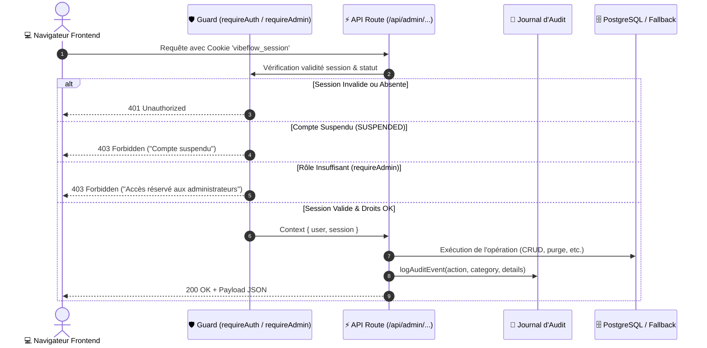

# 🛡️ Architecture de Sécurité, Authentification & Console d'Administration (RBAC)

> [!IMPORTANT]
> **VibeFlow Studio** intègre un système d'authentification robuste et un contrôle d'accès basé sur les rôles (**RBAC** : *Role-Based Access Control*), garantissant l'isolation des projets, la traçabilité intégrale de toutes les actions sensibles via un journal d'audit, ainsi qu'une console d'administration centrale pour le pilotage système et la maintenance des worktrees Git.

---

## 1. Principes Fondamentaux de Sécurité

1. **Zéro Dépendance Vulnérable** : Le hachage des mots de passe utilise l'algorithme cryptographique natif de Node.js `crypto.scryptSync` avec salage individuel aléatoire (16 octets) et clé dérivée (64 octets), éliminant tout risque lié aux modules binaires compilés tiers (comme `bcrypt` ou `argon2`).
2. **Protection Anti-Timing Attack** : La validation des empreintes de mots de passe s'effectue via `crypto.timingSafeEqual`, prévenant toute analyse de temps de réponse par un attaquant réseau.
3. **Sessions Sécurisées sans État Client Non Vérifié** : Les sessions sont stockées côté serveur (avec identifiant UUID cryptographique v4) et transmises via un cookie HTTP sécurisé `vibeflow_session` (`HttpOnly`, `SameSite=Lax`, durée 7 jours).
4. **Résilience Double-Couche (In-Memory Fallback)** : En cas d'indisponibilité momentanée du serveur PostgreSQL, le moteur d'authentification bascule automatiquement et de manière transparente sur un cache sécurisé en mémoire ensemencé avec les comptes par défaut, évitant tout blocage du studio.

---

## 2. Modèle de Rôles et Permissions (RBAC)

VibeFlow applique une matrice de droits stricte entre deux rôles canoniques :

```mermaid
graph TD
    classDef admin fill:#f59e0b,stroke:#b45309,stroke-width:2px,color:#000;
    classDef user fill:#3b82f6,stroke:#1d4ed8,stroke-width:2px,color:#fff;
    classDef action fill:#1e293b,stroke:#475569,stroke-width:1px,color:#fff;

    subgraph Roles
        ADMIN[👑 Rôle ADMIN]:::admin
        USER[👤 Rôle USER]:::user
    end

    subgraph Capacités_Utilisateur
        C1[Accès au Dashboard & Kanban]:::action
        C2[Création & Pilotage de Projets]:::action
        C3[Lancement de Duels Dual-Agent]:::action
        C4[Configuration des CLIs Pro 0€]:::action
        C5[Consultation du Store SkillsMP]:::action
    end

    subgraph Capacités_Administrateur
        A1[Console d'Administration Dédiée]:::action
        A2[Gestion des Comptes Utilisateurs Promote / Demote / Suspend]:::action
        A3[Réinitialisation des Mots de Passe]:::action
        A4[Consultation des Journaux d'Audit AUTH / SECURITY / SYSTEM]:::action
        A5[Purge des Git Worktrees Orphelins /tmp/vibeflow-worktrees/]:::action
        A6[Monitoring Santé PostgreSQL & Métriques Hôte CPU/RAM]:::action
    end

    USER --> C1
    USER --> C2
    USER --> C3
    USER --> C4
    USER --> C5

    ADMIN --> C1
    ADMIN --> C2
    ADMIN --> C3
    ADMIN --> C4
    ADMIN --> C5
    ADMIN --> A1
    ADMIN --> A2
    ADMIN --> A3
    ADMIN --> A4
    ADMIN --> A5
    ADMIN --> A6
```



### Matrice des Droits Détaillée

| Fonctionnalité / Endpoint | Utilisateur Standard (`USER`) | Administrateur (`ADMIN`) |
| :--- | :---: | :---: |
| **Accès Dashboard & Kanban** | ✅ Autorisé | ✅ Autorisé |
| **Création de Projets** | ✅ Autorisé | ✅ Autorisé |
| **Lancement de Débats & Duels** | ✅ Autorisé | ✅ Autorisé |
| **Profil Personnel & Mot de Passe** | ✅ Autorisé | ✅ Autorisé |
| **Liste de tous les Utilisateurs** | ❌ Refusé (403) | ✅ Autorisé |
| **Création Manuelle d'Utilisateurs** | ❌ Refusé (403) | ✅ Autorisé |
| **Changement de Rôle (Promote / Demote)** | ❌ Refusé (403) | ✅ Autorisé |
| **Suspension de Compte (`SUSPENDED`)** | ❌ Refusé (403) | ✅ Autorisé |
| **Suppression de Compte** | ❌ Refusé (403) | ✅ Autorisé (Auto-suppression interdite) |
| **Consultation des Journaux d'Audit** | ❌ Refusé (403) | ✅ Autorisé (Filtrage par catégorie) |
| **Purge des Git Worktrees `/tmp`** | ❌ Refusé (403) | ✅ Autorisé |
| **Test Latence Base de Données** | ❌ Refusé (403) | ✅ Autorisé |

---

## 3. Modèle de Données Prisma

Les modèles ajoutés au schéma Prisma (`prisma/schema.prisma`) :

```prisma
enum UserRole {
  USER
  ADMIN
}

enum UserStatus {
  ACTIVE
  SUSPENDED
  PENDING
}

model User {
  id           String      @id @default(uuid())
  email        String      @unique
  passwordHash String
  name         String
  role         UserRole    @default(USER)
  status       UserStatus  @default(ACTIVE)
  createdAt    DateTime    @default(now())
  updatedAt    DateTime    @updatedAt
  lastLoginAt  DateTime?

  sessions     Session[]
  auditLogs    AuditLog[]
  projects     Project[]
}

model Session {
  id        String   @id @default(uuid())
  token     String   @unique
  userId    String
  user      User     @relation(fields: [userId], references: [id], onDelete: Cascade)
  expiresAt DateTime
  createdAt DateTime @default(now())
  ipAddress String?
  userAgent String?
}

model AuditLog {
  id        String   @id @default(uuid())
  userId    String?
  user      User?    @relation(fields: [userId], references: [id], onDelete: SetNull)
  action    String
  category  String   @default("SYSTEM") // AUTH, USER_MGMT, SYSTEM, DEPLOYMENT, SECURITY
  details   Json?
  ipAddress String?
  userAgent String?
  createdAt DateTime @default(now())
}
```

---

## 4. Architecture des Routes API Sécurisées



### Endpoints Implémentés

- `POST /api/auth/register` : Inscription d'un nouvel utilisateur (le premier utilisateur inscrit reçoit automatiquement le rôle `ADMIN`).
- `POST /api/auth/login` : Authentification, génération de session, cookie `vibeflow_session` et log d'audit.
- `POST /api/auth/logout` : Révocation de session et purge du cookie.
- `GET /api/auth/me` : Données du compte connecté (`SafeUser`).
- `PATCH /api/auth/me` : Modification du profil et changement de mot de passe personnel.
- `GET /api/admin/users` : Liste exhaustive des utilisateurs avec statut, rôle, nombre de projets et dernière connexion.
- `POST /api/admin/users` : Création administrative directe d'un compte.
- `PATCH /api/admin/users/[id]` : Modification du rôle (`USER` $\leftrightarrow$ `ADMIN`), statut (`ACTIVE` $\leftrightarrow$ `SUSPENDED`) ou réinitialisation de mot de passe.
- `DELETE /api/admin/users/[id]` : Suppression d'un compte (avec garde-fou interdisant l'auto-suppression de l'admin connecté).
- `GET /api/admin/audit-logs` : Consultation chronologique des journaux d'audit avec filtrage catégoriel.
- `GET /api/admin/system` : Rapport de santé hôte (CPU, RAM, Uptime, version Node, statut PostgreSQL, liste des worktrees actifs).
- `POST /api/admin/system` : Déclenchement de la purge des dossiers `/tmp/vibeflow-worktrees/` ou test de latence base de données.

---

## 5. Interface Utilisateur & Intégration Visuelle

1. **TopBar Interactive (`src/components/layout/TopBar.tsx`)** :
   - Affichage de l'avatar utilisateur avec badge de rôle dynamique : `ADMIN` en doré (`bg-amber-500/20 text-amber-300`) ou `USER` en bleu (`bg-blue-500/20 text-blue-300`).
   - Menu déroulant avec informations du profil, indicateur de statut en temps réel, lien d'accès à la **Console d'Administration** (visible uniquement pour les administrateurs) et bouton de déconnexion.
   - Bouton "Se Connecter" avec ouverture de la boîte de dialogue si l'utilisateur est invité.
2. **Boîte d'Authentification (`src/components/auth/AuthDialog.tsx`)** :
   - Onglets "Connexion" et "Inscription".
   - Bouton d'accès rapide en environnement de test (1-clic pour remplir les identifiants Admin ou Dev par défaut).
3. **Console d'Administration Complète (`src/components/admin/AdminConsoleModal.tsx`)** :
   - **Onglet 1 : Utilisateurs & Droits** : Tableau de bord des comptes, promotion/rétrogradation instantanée de rôle, suspension en un clic, réinitialisation de mot de passe et suppression protégée.
   - **Onglet 2 : Journaux d'Audit** : Visualisation en direct de tous les événements avec pastilles de sévérité et métadonnées JSON détaillées.
   - **Onglet 3 : Santé Système & Worktrees** : Métriques système en direct (RAM utilisée, cœurs CPU, latence DB, nombre de worktrees actifs) et bouton de purge complète des worktrees orphelins.

---

## 6. Comptes Initiaux par Défaut (Environnement Local & Démo)

| Rôle | Adresse Email | Mot de Passe par Défaut | Usage |
| :--- | :--- | :--- | :--- |
| **ADMIN** | `admin@vibeflow.local` | `AdminVibe2026!` | Administration globale de la solution |
| **USER** | `dev@vibeflow.local` | `UserVibe2026!` | Développeur standard & création de projets |

> [!TIP]
> Lors du premier lancement en production sur une base de données vierge, le premier compte créé via le formulaire d'inscription se voit automatiquement attribuer le rôle **ADMIN**. Tous les comptes suivants sont créés avec le rôle **USER** par défaut.
