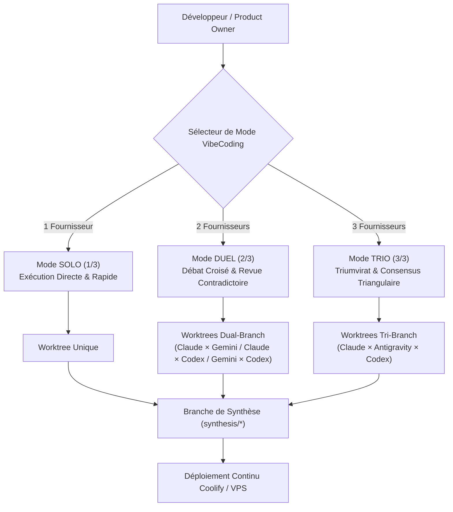

# VibeFlow Studio — Architecture Multi-Forfaits & Moteur VibeCoding Multi-Modèles

> **Statut :** Production Active  
> **Dernière mise à jour :** 2026-11-07  
> **Composants :** Claude Code CLI, Gemini / Antigravity CLI, ChatGPT Codex CLI & APIs  
> **Modes supportés :** Mode SOLO (1 IA), Mode DUEL (2 IA), Mode TRIO / TRIUMVIRAT (3 IA)

---

## 1. Vue d'Ensemble & Vision

VibeFlow Studio permet de connecter **n'importe quel forfait** de Claude, Gemini et ChatGPT Codex, et d'orchestrer la génération de code soit avec **1 fournisseur unique** (Solo), **2 fournisseurs en confrontation croisée** (Duel), ou **les 3 fournisseurs simultanément** (Trio).

---

## 2. Matrice des Forfaits Supportés

Chaque fournisseur propose plusieurs paliers de forfaits, tous configurables et testables en temps réel dans l'interface :

### A. Claude (Anthropic)
1. **Claude Free Tier :** Accès limité avec Sonnet 3.5 / Haiku via CLI ou fallback.
2. **Claude Pro ($20/mois) :** 5x plus de quota, Claude Code CLI illimité selon le fair-use.
3. **Claude Team / Max ($30/mois/utilisateur) :** Priorité d'accès aux heures de pointe et quotas étendus.
4. **Clé API Anthropic (`sk-ant-...`) :** Facturation au jeton (Pay-as-you-go), utilisé en overage / secours.

### B. Gemini (Google AI Studio / Google One)
1. **Google AI Studio Free Tier (0€) :** 15 requêtes / minute, 1 500 requêtes / jour sur Gemini 2.5 Flash / Pro.
2. **Gemini Advanced (Google One AI Premium - 21,99€/mois) :** Intégration Antigravity CLI native.
3. **Gemini Enterprise (Google Cloud Vertex AI) :** Quotas d'entreprise avec SLA garanti.
4. **Clé API Google Gemini (`AIza...`) :** Facturation au jeton via Google AI Studio / GCP.

### C. ChatGPT Codex (OpenAI)
1. **ChatGPT Free :** Accès de base GPT-4o-mini avec limitation de requêtes.
2. **ChatGPT Plus ($20/mois) :** Accès prioritaire GPT-4o et ChatGPT Codex CLI (`codex`).
3. **ChatGPT Pro ($200/mois) :** Accès illimité aux modèles de raisonnement avancé (o1, o3-mini) et grand débit.
4. **Clé API OpenAI (`sk-...`) :** Facturation directe au jeton pour GPT-4o, o1, o3-mini.

---

## 3. Les Trois Modes d'Exécution VibeCoding

| Mode | Nombre d'IA | Fournisseurs Actifs | Cas d'Usage Idéal | Rapidité & Coût |
| :--- | :---: | :--- | :--- | :--- |
| **SOLO** | 1 | Claude, Gemini ou Codex | Tâches ciblées, scripts, corrections de bugs rapides | Ultra-rapide, 0€ de jeton additionnel |
| **DUEL** | 2 | Claude × Gemini Claude × Codex Gemini × Codex | Nouvelles fonctionnalités, refactoring critique, challenge d'architecture | Modéré, consensus contradictoire de haute qualité |
| **TRIO** | 3 | Claude + Gemini + Codex | Architecture d'envergure, modules critiques, production-ready | Synergie suprême : Typage + Fluidité UX + Algorithmes |

---

## 4. Spécialisation des Agents en Mode TRIO

Lorsqu'il tourne en mode TRIO, chaque agent se voit assigner une responsabilité précise :
- **Claude Code :** Architecture logicielle, robustesse transactionnelle, typage strict TypeScript, sécurité et gestion des cas limites.
- **Antigravity (Gemini) :** Ergonomie utilisateur, animations à 60 FPS, feedback visuel/haptique instantané, transitions optimistes.
- **ChatGPT Codex (OpenAI) :** Complexité algorithmique (O(1)), structures de données optimisées, pipelines asynchrones non-bloquants et scalabilité mémoire.

---

## 5. Stockage Sécurisé & Intégrité

- **Chiffrement :** Toutes les clés API sont chiffrées en AES-256-CBC avec vecteur d'initialisation aléatoire (`src/lib/utils.ts`).
- **Persistance :** Paramètres enregistrés de façon dynamique dans la table `SystemSetting` (`vibecoding_engine_config`, `ai_providers_custom_settings`), garantissant 0 régression de schéma SQL.
- **Priorité Zéro-Jeton :** Par défaut, VibeFlow utilise les abonnements Pro / CLI connectés localement afin de préserver les crédits payants.
